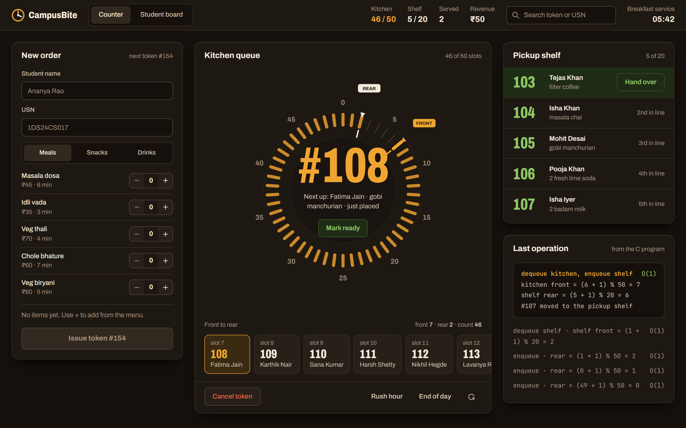
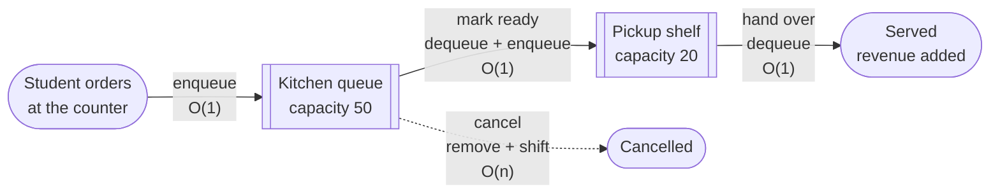
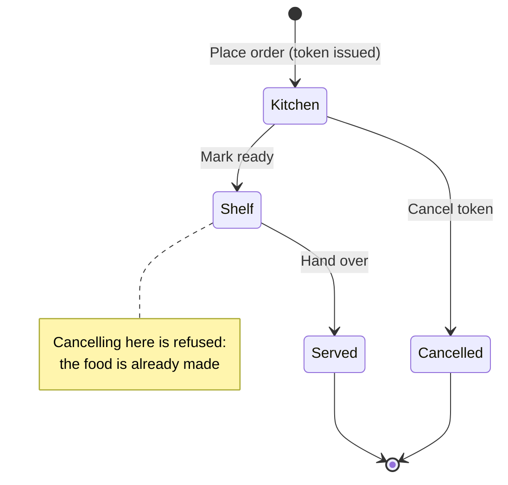
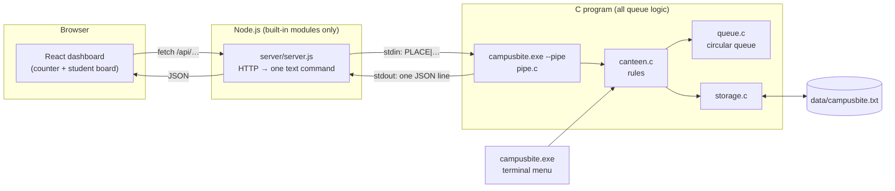
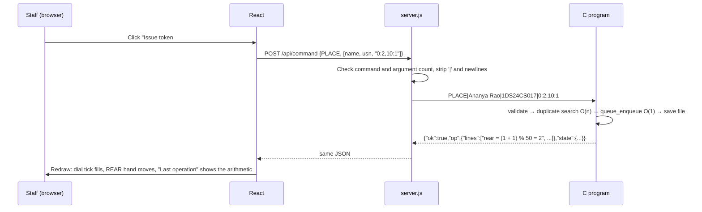
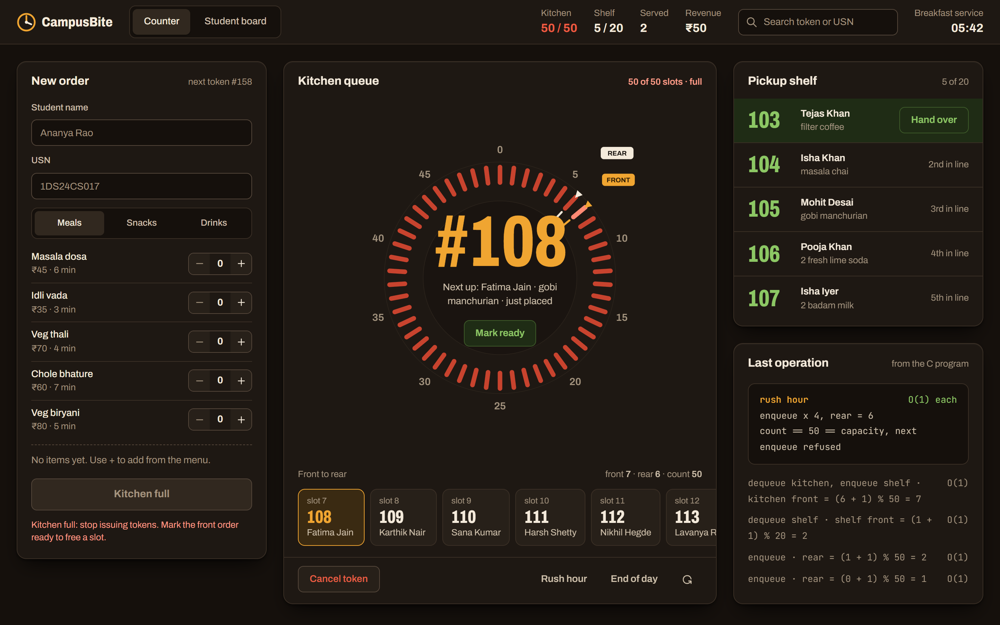
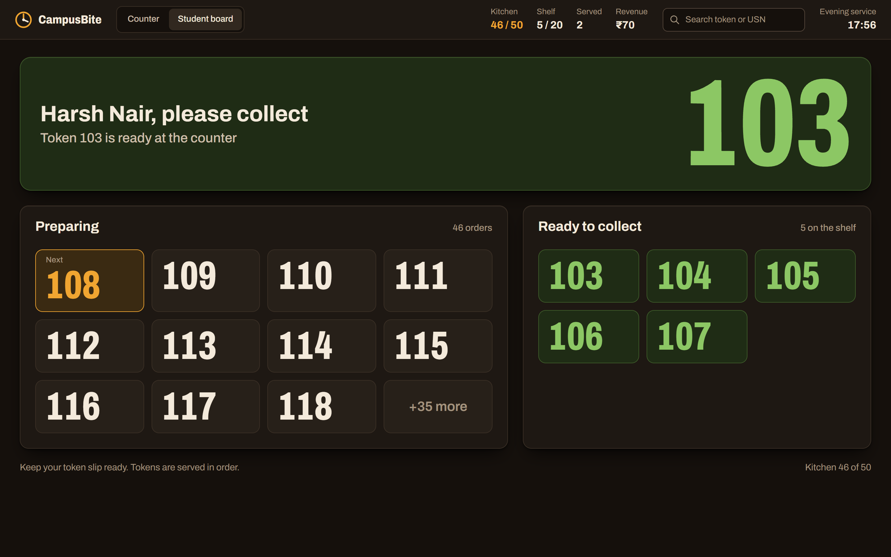
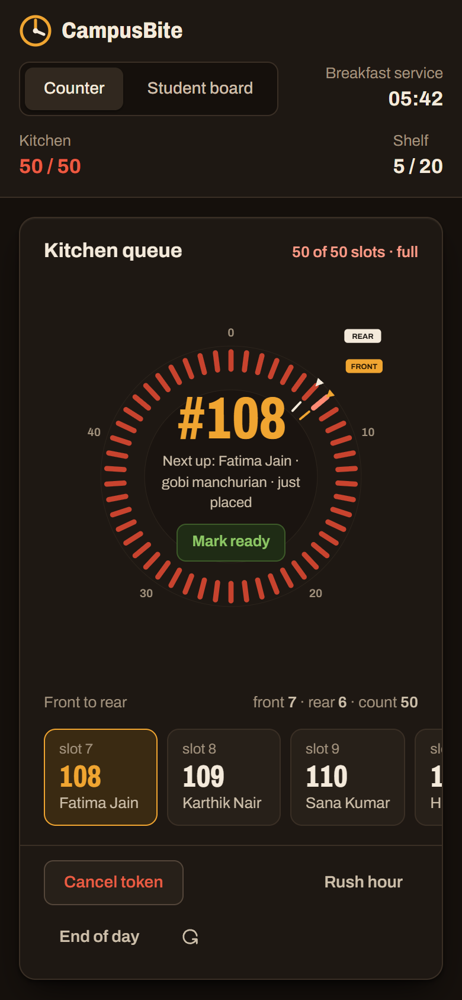

<div align="center">

# CampusBite

### College canteen token management system, built on a circular queue


**DSA Capstone AAT** · 1BAI303 Data Structures and Applications · III Semester · 2026–27



</div>

---

## Contents

1. [In one minute](#in-one-minute)
2. [The problem](#the-problem)
3. [The approach](#the-approach)
4. [Why a circular queue](#why-a-circular-queue)
5. [How the circular queue works](#how-the-circular-queue-works)
6. [Operations and time complexity](#operations-and-time-complexity)
7. [Canteen rules on top of the queue](#canteen-rules-on-top-of-the-queue)
8. [Edge cases](#edge-cases)
9. [System architecture](#system-architecture)
10. [The terminal program](#the-terminal-program)
11. [The dashboard](#the-dashboard)
12. [The pipe protocol (C ⇄ dashboard)](#the-pipe-protocol-c--dashboard)
13. [Saving and loading](#saving-and-loading)
14. [Project structure](#project-structure)
15. [Build and run](#build-and-run)
16. [Testing](#testing)
17. [Design decisions and trade-offs](#design-decisions-and-trade-offs)
18. [Limitations and future work](#limitations-and-future-work)
19. [The ordering app (app/)](#the-ordering-app-app)
20. [Team](#team)
21. [AI usage](#ai-usage)

---

## In one minute

| | |
|---|---|
| **What** | A token system for a college canteen: every order gets a token, tokens are served strictly in order, and the counter stops issuing tokens when the kitchen is full. |
| **Data structure** | A **circular queue on a fixed array**, written by hand in C. There are two of them: a kitchen queue (50 slots) and a pickup shelf (20 slots). |
| **Program** | A menu-driven C program, which is the graded part. It runs on its own in the terminal. |
| **Extra** | A live web dashboard (React) that talks to the same C program through a small Node bridge. All the queue work still happens in C. |
| **Proof** | 94 automated tests, plus every edge case visible on screen: empty, full, not found, duplicate, invalid input. |

---

## The problem

At lunch the canteen counter is crowded:

- **Students get skipped.** Without a fixed order, whoever pushes to the front is served first.
- **The kitchen overloads.** The counter keeps taking orders the kitchen can't cook, so everyone waits longer.
- **Nobody can see the queue.** Students don't know when their food is ready, so they crowd the counter.

CampusBite turns each of these into a rule the data structure enforces:

| Real-world rule | How the data structure enforces it |
|---|---|
| First come, first served | A queue is FIFO: the oldest order is always served next |
| The kitchen can hold only 50 orders | The queue has a fixed capacity: when it's full, no new token is issued |
| One active order per student | Before enqueueing, the USN is searched for in both queues |
| Ready food waits on a shelf of limited size | A second queue, of capacity 20, between the kitchen and the student |

---

## The approach

An order moves through **two circular queues**. Every move is a queue operation.



The life of a single order:



**What makes this work:**

1. **The capacity is the business rule.** "Queue full" isn't treated as an error. It means "stop issuing tokens" (kitchen) or "hand over before marking more ready" (shelf).
2. **Two queues, not one.** A slow pickup can't block the kitchen's count, and the shelf's own limit stops ready food from piling up.
3. **The C program is the single source of truth.** The dashboard never keeps a queue of its own. It sends commands and redraws whatever state C sends back.

---

## Why a circular queue

| Requirement | What the circular queue gives |
|---|---|
| Fair order | FIFO: insert at the rear, remove from the front |
| Hard capacity | A fixed array of `capacity` slots |
| Runs all day without wasting space | Indices wrap with `(i + 1) % capacity`, so freed slots are reused |
| Fast at the counter | Enqueue, dequeue, peek and the full/empty checks are all **O(1)** |

### Why not another structure?

| Structure | Why it doesn't fit |
|---|---|
| **Linear array queue** | `rear` only moves forward. After 50 orders it reaches the end and reports **full even though the front slots are empty** ("false overflow"). Fixing that means shifting every element, which is O(n) per dequeue. |
| **Linked-list queue** | Has no natural capacity. We would have to add one, which is the very rule a fixed array already gives. It also needs a `malloc`/`free` per order and extra pointer memory. |
| **Priority queue / heap** | Serves by priority, not arrival. Nobody should jump the line, and insert costs O(log n). |
| **Stack** | LIFO would serve the newest order first, which is the opposite of fair. |
| **Deque** | Allows insert and remove at both ends. A canteen line only ever needs rear-in and front-out, so the extra freedom would only allow mistakes. |

---

## How the circular queue works

### The structure ([`src/queue.h`](src/queue.h))

```c
typedef struct {
    Order items[MAX_QUEUE_SIZE];  /* the circular buffer              */
    int   front;                  /* index of the oldest order        */
    int   rear;                   /* index of the newest order        */
    int   count;                  /* number of orders stored          */
    int   capacity;               /* slots in use: 1..MAX_QUEUE_SIZE  */
} Queue;
```

**Invariants** (always true between operations):

```
0 ≤ count ≤ capacity
empty  ⇔  count == 0
full   ⇔  count == capacity
the k-th order from the front sits in slot (front + k) % capacity
rear == (front + count - 1) % capacity        (when count > 0)
```

We detect full and empty with a **`count` variable** rather than the "leave one slot empty" trick. That way all `capacity` slots are usable, and both checks are one comparison.

### The two core operations ([`src/queue.c`](src/queue.c))

```c
QueueStatus queue_enqueue(Queue *q, const Order *order)
{
    if (q == NULL || order == NULL)
        return Q_INVALID;
    if (queue_is_full(q))
        return Q_FULL;                      /* kitchen at capacity */

    q->rear = (q->rear + 1) % q->capacity;  /* step forward, wrap to 0 */
    q->items[q->rear] = *order;             /* copy the order in       */
    q->count++;
    return Q_OK;
}

QueueStatus queue_dequeue(Queue *q, Order *out)
{
    if (q == NULL)
        return Q_INVALID;
    if (queue_is_empty(q))
        return Q_EMPTY;                     /* nothing to serve */

    if (out != NULL)
        *out = q->items[q->front];          /* copy the oldest order out */
    q->front = (q->front + 1) % q->capacity;
    q->count--;
    return Q_OK;
}
```

`queue_init` sets `front = 0`, `rear = -1` and `count = 0`, so the first enqueue computes `(−1 + 1) % capacity = 0` and lands in slot 0.

### A step-by-step trace (capacity 5)

| Step | Operation | front | rear | count | Array (slots 0 → 4) | Note |
|---|---|---|---|---|---|---|
| 0 | `init` | 0 | −1 | 0 | `[ ·   ·   ·   ·   · ]` | empty |
| 1 | enqueue 101 | 0 | 0 | 1 | `[101  ·   ·   ·   · ]` | rear = (−1+1)%5 = 0 |
| 2 | enqueue 102…105 | 0 | 4 | 5 | `[101 102 103 104 105]` | **full** |
| 3 | enqueue 106 | 0 | 4 | 5 | unchanged | refused: `Q_FULL` |
| 4 | dequeue → 101 | 1 | 4 | 4 | `[ ·  102 103 104 105]` | front = (0+1)%5 = 1 |
| 5 | dequeue → 102 | 2 | 4 | 3 | `[ ·   ·  103 104 105]` | slots 0 and 1 are free |
| 6 | enqueue 106 | 2 | **0** | 4 | `[106  ·  103 104 105]` | **wrap**: rear = (4+1)%5 = 0 |
| 7 | enqueue 107 | 2 | 1 | 5 | `[106 107 103 104 105]` | full again, nothing wasted |
| 8 | dequeue ×5 | 2 | 1 | 0 | `[ ·   ·   ·   ·   · ]` | served 103, 104, 105, 106, 107: still FIFO |

A linear array queue would have reported "full" at step 6 even though slots 0 and 1 were empty.

### Cancelling from the middle (O(n))

A queue normally only removes from the front, but a student may cancel. `queue_remove_token` finds the order, then **shifts every order behind it one slot toward the front**, so everyone else keeps their place in line:

```
before:  front → [103] [104] [105] [106] [107] ← rear      cancel 105
after:   front → [103] [104] [106] [107]       ← rear      106 and 107 moved up one slot
                                                             rear = (rear − 1 + cap) % cap
```

The shift also works across the wrap point; the tests cover that. Only orders still **in the kitchen** can be cancelled. An order on the shelf is already cooked.

---

## Operations and time complexity

| Operation | Function | Used for | Time | Space |
|---|---|---|---|---|
| Create | `queue_init` | Start of day / new day | O(1) | O(1) |
| Enqueue | `queue_enqueue` | Issue a token; move an order onto the shelf | **O(1)** | O(1) |
| Dequeue | `queue_dequeue` | Mark ready (kitchen); hand over (shelf) | **O(1)** | O(1) |
| Peek | `queue_peek` | Show the next token | **O(1)** | O(1) |
| isEmpty / isFull / size | `queue_is_empty` … | Edge-case checks, readouts | **O(1)** | O(1) |
| k-th from front | `queue_at`, `queue_slot_of` | Display, traversal | O(1) each | O(1) |
| Traverse | loop over `queue_at` | Show the whole queue | O(n) | O(1) |
| Search | `queue_find_token`, `queue_find_usn` | Find an order; duplicate-USN check | O(n) | O(1) |
| Cancel | `queue_remove_token` | Remove from the middle and shift | O(n) | O(1) |
| Save / load | `storage_save`, `storage_load` | Survive a restart | O(n) | O(n) file |

`n` is the number of orders currently stored (at most 50). The queue uses a fixed `50 × sizeof(Order)` array: no dynamic memory at all.

---

## Canteen rules on top of the queue

These live in [`src/canteen.c`](src/canteen.c).

### Order data ([`src/order.h`](src/order.h))

| Field | Type | Meaning |
|---|---|---|
| `token` | `int` | Token number (starts at 101 each day) |
| `name` | `char[40]` | Student name |
| `usn` | `char[11]` | 10-character USN |
| `items[10]` | `{item_id, qty}` | Up to 10 different menu items |
| `total` | `int` | Bill in rupees |
| `placed_at` | `time_t` | When the token was issued |

### Validation

| Input | Rule | Example |
|---|---|---|
| USN | Exactly 10 characters, pattern `digit · 2 letters · 2 digits · 2 letters · 3 digits`. Upper-cased automatically. | `1DS24CS017` (all USNs in this repo are invented) |
| Name | 2–39 characters: letters, spaces, `.`, `-`, apostrophe; at least 2 letters | `Ananya Rao` |
| Items | 1–10 different items, each quantity 1–10, item must exist on the menu | 2 × Masala dosa |
| Duplicate | One active order per USN, checked in **both** queues | |

### Estimated wait

```
wait = ⌈ (sum of prep minutes of every order in the kitchen) / 3 cooks ⌉ + your own order's prep time
```

An order's prep time is the time of its **slowest** item. The order is ready when everything in it is ready.

### Menu (demo prices)

| Meals | ₹ | min | Snacks | ₹ | min | Drinks | ₹ | min |
|---|---|---|---|---|---|---|---|---|
| Masala dosa | 45 | 6 | Samosa (2) | 20 | 2 | Filter coffee | 15 | 1 |
| Idli vada | 35 | 3 | Vada pav | 25 | 2 | Masala chai | 12 | 1 |
| Veg thali | 70 | 4 | Gobi manchurian | 50 | 6 | Fresh lime soda | 30 | 2 |
| Chole bhature | 60 | 7 | Paneer roll | 55 | 5 | Mango lassi | 40 | 2 |
| Veg biryani | 80 | 5 | Bhel puri | 30 | 3 | Badam milk | 35 | 1 |

---

## Edge cases

Every case the brief asks for, with the exact message the program shows:

| Case | When | Message |
|---|---|---|
| **Empty** | Mark ready with no orders | "No orders in the kitchen." |
| **Empty** | Hand over with an empty shelf | "Nothing on the pickup shelf." |
| **Full** | 51st token | "Kitchen full: stop issuing tokens. Mark the front order ready to free a slot." |
| **Full** | Mark ready with the shelf at 20/20 | "Pickup shelf full: hand over the front order first." (the order safely stays in the kitchen) |
| **Not found** | Cancel or search an unknown token | "Token not found." / "No active order matches …" |
| **Duplicate** | Same USN again | "1DS24CS017 already has token 101 in the kitchen. Hand it over or cancel it first." |
| **Invalid input** | Bad USN, name, item or quantity | "USN must be 10 characters like 1DS24CS017." … |
| **Invalid input** | Letters typed where a number goes in the menu | "Enter a whole number from 0 to 12." (asks again) |
| **Not allowed** | Cancel an order that's on the shelf | "That order is already on the pickup shelf, so it can't be cancelled." |
| **Damaged save file** | Corrupt `data/campusbite.txt` | Starts a fresh day instead of crashing |

---

## System architecture



**The same C code runs in two modes:**

| Mode | Started as | Who uses it |
|---|---|---|
| Terminal menu | `campusbite.exe` | A person at the keyboard. This is the menu-driven program the brief asks for. |
| Pipe mode | `campusbite.exe --pipe` | The Node bridge, on behalf of the dashboard |

### What happens when you click "Issue token"



The bridge sends **one command at a time**, in order, so two clicks can never interleave inside the C program.

---

## The terminal program

Start it with `.\build.bat run`:

```
========================================================================
  CAMPUSBITE  canteen token system      kitchen 16/50   shelf  4/20
========================================================================
   1. Place order (issue token)        8. Cancel a token
   2. Mark next order ready            9. Show canteen menu
   3. Hand over next ready order      10. Rush hour (fill the kitchen)
   4. Show next token                 11. End of day summary
   5. Show kitchen queue              12. Start a new day
   6. Show pickup shelf
   7. Search by token or USN           0. Save and exit
```

**Show kitchen queue** draws the actual array (`#` = used slot, `.` = free slot, `F` = front, `R` = rear). After a wrap-around, `R` sits just behind `F`:

```
KITCHEN QUEUE  50 / 50 slots used  [FULL]

  slot 0         1         2         3         4
       ##################################################
         RF
  front = 3   rear = 2   count = 50   next rear = (rear + 1) % 50 = 3
```

**Place order** prints a token slip:

```
  +--------------------------------------+
  |  CampusBite canteen                  |
  |  TOKEN  101                          |
  |  Ananya Rao                          |
  |  1DS24CS017                          |
  +--------------------------------------+
  |   2x Masala dosa             Rs90    |
  |   1x Filter coffee           Rs15    |
  +--------------------------------------+
  |  Total                    Rs105      |
  |  Estimated wait           6   min    |
  +--------------------------------------+
  enqueue -> kitchen slot 0 (rear), O(1)
```

Input is read with `fgets` + `strtol`, so typing letters, empty lines or overly long lines never crashes it; it just asks again.

---

## The dashboard

| Kitchen full (50/50): new tokens refused | Student token board | Phone width |
|---|---|---|
|  |  |  |

### Counter view (staff)

| Area | What it shows | Queue operation behind it |
|---|---|---|
| **New order** | Name, USN, menu with quantities, live bill and estimated wait | `PLACE` → enqueue |
| **Kitchen queue dial** | One tick per array slot (50). Amber = used, red = full. **FRONT** and **REAR** hands point at the real indices and only turn forward, so you can watch them wrap past slot 0. | the array itself |
| **Next up + Mark ready** | The front order | `READY` → dequeue + enqueue |
| **Front-to-rear strip** | Each order with its slot index | traversal |
| **Pickup shelf** | Ready orders. Only the **front** one has Hand over, because the shelf is FIFO too. | `HANDOVER` → dequeue |
| **Last operation** | The C program's own arithmetic, for example `rear = (8 + 1) % 50 = 9`, with its complexity | reported by C |
| **Tools** | Cancel token, Rush hour (fill to 50), End of day, New day | `CANCEL`, `RUSH`, `SUMMARY`, `NEWDAY` |
| **Top bar** | Kitchen/shelf readouts (turn amber at 60% and red when full), served, revenue, search | `SEARCH` |

### Student board

Open `http://localhost:3001/#board` on a second screen. It shows the token being called in large digits, plus the **Preparing** and **Ready to collect** columns. It refreshes every 2 seconds, so it stays in step with the counter.

### Design

The look follows a warm, dark "kitchen display" theme. Each colour has one meaning: turmeric for preparing/next, curry-leaf green for ready, chilli red for full/error. State is never shown by colour alone; every state is also stated in words. Typeface: Archivo (with condensed digits for token numbers); monospace is used only for the C readout. The full system is in [DESIGN.md](DESIGN.md), and the product facts are in [PRODUCT.md](PRODUCT.md).

---

## The pipe protocol (C ⇄ dashboard)

One command per line on stdin, one JSON line back on stdout ([`src/pipe.c`](src/pipe.c)).

| Command | Arguments | Does | Queue work |
|---|---|---|---|
| `STATE` | none | Return the current state | none |
| `MENU` | none | Return the menu and limits | none |
| `PLACE` | `name\|usn\|id:qty,id:qty` | Issue a token | enqueue |
| `READY` | none | Kitchen front → shelf | dequeue + enqueue |
| `HANDOVER` | none | Shelf front → served | dequeue |
| `CANCEL` | `token` | Cancel a kitchen order | remove + shift |
| `SEARCH` | `token or USN` | Find an active order | linear search |
| `RUSH` | none | Fill the kitchen with demo orders | enqueue × n |
| `SUMMARY` | none | End-of-day totals | none |
| `NEWDAY` | none | Clear both queues | init |

Example: `READY` returns (state trimmed):

```json
{
  "ok": true,
  "code": "OK",
  "message": "Token 101 is ready.",
  "op": {
    "name": "dequeue kitchen, enqueue shelf",
    "complexity": "O(1)",
    "lines": ["kitchen front = (0 + 1) % 50 = 1", "shelf rear    = (-1 + 1) % 20 = 0", "#101 moved to the pickup shelf"]
  },
  "state": {
    "nextToken": 102, "served": 0, "revenue": 0, "prepAhead": 0, "cooks": 3,
    "kitchen": { "capacity": 50, "front": 1, "rear": 0, "count": 0, "orders": [] },
    "shelf":   { "capacity": 20, "front": 0, "rear": 0, "count": 1, "orders": [ { "slot": 0, "token": 101, "...": "..." } ] }
  }
}
```

Errors come back the same way with `"ok": false` and a `code` (`KITCHEN_FULL`, `SHELF_FULL`, `DUPLICATE_USN`, `INVALID_USN`, `NOT_FOUND`, `ALREADY_READY`, …), so the dashboard always shows the C program's own message.

HTTP routes on the bridge: `GET /api/state`, `GET /api/menu`, `POST /api/command` with `{"command": "...", "args": [...]}`. Anything else serves the built dashboard. The bridge accepts only the 10 commands above, with the right number of arguments.

---

## Saving and loading

After every change the program writes `data/campusbite.txt` ([`src/storage.c`](src/storage.c)), and it reloads the file on start:

```
CAMPUSBITE 1
STATS 156 4 1 219                 ← next_token served cancelled revenue
KITCHEN 2                         ← count, then orders front → rear
106|Arjun Hegde|1DS25ME129|1795262748|40|13:1
107|Sneha Patil|1DS23EC141|1795262748|90|0:2
SHELF 1
105|Ravi Kumar|1DS24ME112|1795262700|105|0:2,10:1
```

Orders are written **from front to rear**, so loading them back with ordinary `enqueue` rebuilds each queue in exactly the same FIFO order. That's O(n), with no special code. A damaged or half-written file is detected and the day starts clean.

---

## Project structure

```
CampusBite/
├── src/                     C program: the graded part
│   ├── order.h              Order struct (one queue slot)
│   ├── queue.h / queue.c    ★ circular queue: init, enqueue, dequeue, peek, search, cancel
│   ├── canteen.h / .c       menu, validation, duplicate check, kitchen → shelf → served, wait time
│   ├── storage.h / .c       save and load to data/campusbite.txt
│   ├── pipe.h / pipe.c      --pipe mode: one command in, one JSON line out
│   └── main.c               12-option terminal menu, safe input
├── tests/
│   ├── test_queue.c         47 checks on the data structure
│   └── test_canteen.c       47 checks on rules, capacity, save/load
├── server/
│   └── server.js            Node bridge (built-in modules only)
├── dashboard/               React + Vite dashboard
│   └── src/
│       ├── App.jsx          state, polling, command runner
│       ├── api.js           the three HTTP calls
│       └── components/      TopBar, OrderForm, KitchenQueue, KitchenDial,
│                            PickupShelf, LastOperation, StudentBoard
├── design/preview.html      the original static design preview
├── docs/screenshots/        images used in this README
├── build.bat                compile the program and tests (MinGW gcc)
├── start.bat                one command: build everything and open the dashboard
├── PRODUCT.md               product facts: users, rules, constraints
├── DESIGN.md                design system: colours, type, components
└── AI_LOG.md                AI usage log
```

**Lines of responsibility:** `queue.c` knows nothing about canteens. `canteen.c` knows nothing about screens. `main.c` and `pipe.c` are two front-ends for the same rules.

---

## Build and run

### Requirements

| Tool | Version used | Needed for |
|---|---|---|
| MinGW gcc | 6.3 (any C99 compiler works) | the C program and tests |
| Node.js | 18 or newer (developed on 24) | the bridge and the dashboard build |
| npm | comes with Node | installing dashboard packages (first run only) |

### Everything in one command

```powershell
.\start.bat
```

It compiles the C program, installs and builds the dashboard (the first run needs internet for npm), starts the bridge, and opens **http://localhost:3001**. Press `Ctrl+C` to stop.

### Only the terminal program

```powershell
.\build.bat run
```

### Only the tests

```powershell
.\build.bat test
```

### Dashboard development mode (hot reload)

```powershell
.\build.bat
node server\server.js          # terminal 1: bridge on port 3001
cd dashboard; npm run dev      # terminal 2: Vite on port 5173, /api proxied to 3001
```

> Don't run the terminal menu and the dashboard at the same time: both save to the same `data/campusbite.txt`.

### Building manually (any OS with gcc)

```bash
gcc -std=c99 -Wall -Wextra -pedantic -o campusbite src/main.c src/pipe.c src/canteen.c src/storage.c src/queue.c
```

---

## Testing

```
> .\build.bat test
CampusBite circular queue tests
[init] [empty queue] [FIFO order] [full queue] [wrap-around] [search] [cancel token] [cancel when rear is slot 0]
47 passed, 0 failed
CampusBite canteen tests
[input validation] [order flow] [capacity rules] [save and load]
47 passed, 0 failed
```

| Suite | What it proves |
|---|---|
| **init** | Capacity 0, negative, above 50 and NULL are rejected; a new queue is empty |
| **empty** | Dequeue, peek, search and cancel on an empty queue fail safely |
| **FIFO** | Tokens come out in the order they went in; peek removes nothing |
| **full** | 50 fit, the 51st is refused, and a refused enqueue changes nothing |
| **wrap-around** | Freed slots are reused, `rear` wraps 4 → 0, and order holds across the wrap |
| **search** | Token and USN search, unknown values, NULL input |
| **cancel** | Middle, front and rear removal; shifting across the wrap; `rear` stepping back from slot 0 |
| **validation** | USN pattern, lower-case USNs, names with symbols or digits |
| **order flow** | Bill and prep time, duplicates (in the kitchen and on the shelf), cancel refused on the shelf, the USN is free again after hand over |
| **capacity** | Rush hour fills to 50; shelf full blocks mark ready without losing the order |
| **save/load** | Round trip keeps FIFO order, names with spaces and totals; missing and damaged files are handled |

Everything compiles with `-Wall -Wextra -pedantic` with **zero warnings**.

---

## Design decisions and trade-offs

| Decision | Why | Trade-off |
|---|---|---|
| `count` variable for full/empty | Every slot is usable and both checks are one comparison | One extra integer to keep in sync |
| Fixed array, no `malloc` | Capacity is a real rule; no leaks, no fragmentation | Capacity is set at compile time (`KITCHEN_CAPACITY`, `SHELF_CAPACITY`) |
| Store `Order` by value in the slot | The queue owns its data; no dangling pointers | Copies about 140 bytes per move, which is trivial at this size |
| Two queues instead of one with a status flag | Each stage keeps true FIFO and its own capacity | Moving an order is a dequeue plus an enqueue |
| Cancel shifts the elements | Keeps everyone else's place in line | O(n) instead of O(1), acceptable for at most 50 |
| Duplicate check by linear search | Simple and exact | O(n) per order; a hash set would make it O(1) |
| C does all the logic; JS only displays | The data structure stays the heart of the program, as the brief requires | Needs the small Node bridge |
| Plain text save file | Human-readable, easy to explain | Not safe for two programs writing at once |

---

## Limitations and future work

- **One counter, one kitchen.** Several counters would need one queue per counter, or a shared server process.
- **No login.** Anyone with the dashboard open can issue or cancel tokens.
- **The wait estimate is simple.** It assumes 3 cooks working in parallel and ignores what is already half-cooked.
- **The duplicate check is O(n).** A hash set of active USNs would make it O(1) if capacity grew a lot.
- **One process at a time** should write the save file.
- **Possible extensions:** SMS or notification when a token is ready, a separate counter per food section, daily sales charts, a printed token slip.

---

## The ordering app (app/)

After the capstone version above was finished (tagged `capstone-v1`), we built a second, separate project in the `app/` folder: a canteen ordering website. Students order and pay (pretend payment) on their phones and get a token; the canteen owner sees incoming orders on a 50-slot circular-queue dial and manages stock. If a dish runs out after paying, the student is refunded to a canteen wallet or the original UPI / card. It also has dish photos, calories and a high-protein filter.

It is written in JavaScript (Node.js server with SQLite, React screens) and does not change the C program. How to run it and the full feature list are in **[app/README.md](app/README.md)**.

---

## Team

| Name | USN | Role |
|---|---|---|
| _Member 1_ | _USN_ | Circular queue core (`queue.c`, `queue.h`), queue tests |
| _Member 2_ | _USN_ | Canteen rules, storage, terminal menu, canteen tests |
| _Member 3_ | _USN_ | Pipe mode, Node bridge, React dashboard |

---

## AI usage

Built with **Claude Code** (Claude Opus 5.5) as a pair programmer, with the impeccable design skill for the dashboard. The team chose the problem, the data structure, the scope, the design and the stack, and checked every phase by running the tests and the program. Every key prompt, what the AI produced and what we decided is in **[AI_LOG.md](AI_LOG.md)**.

<div align="center">

All names, USNs and prices in the demo data are invented.

</div>
